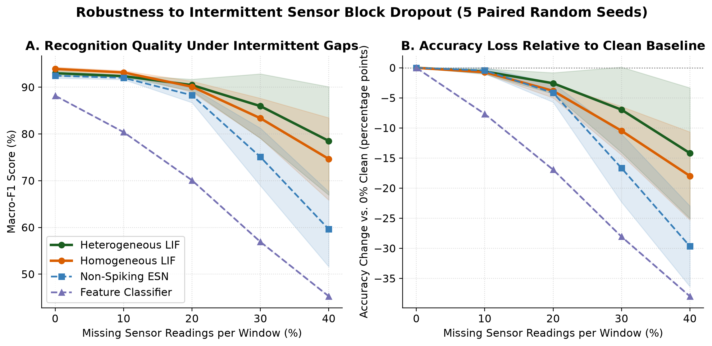
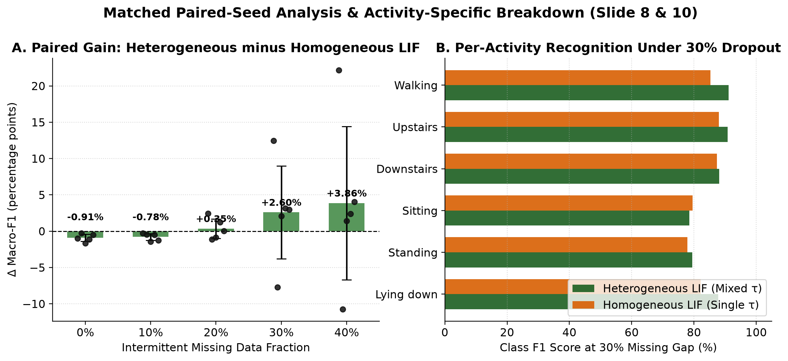
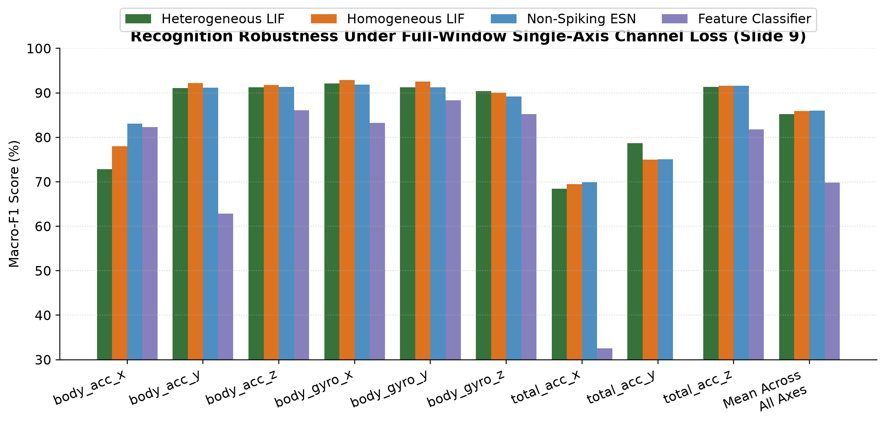
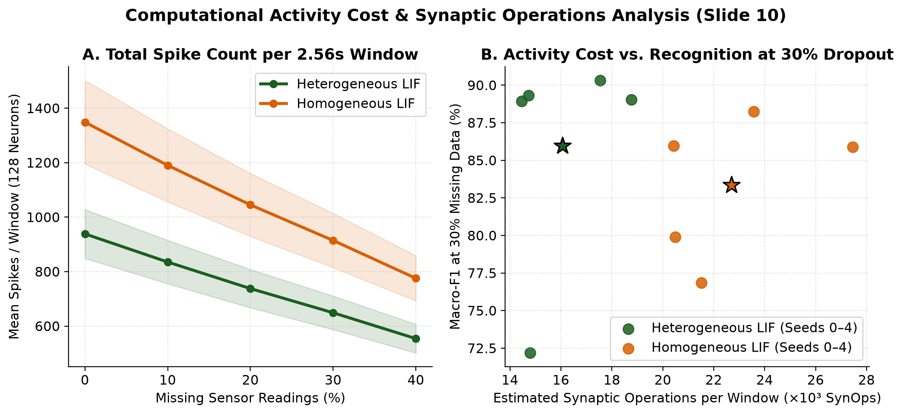
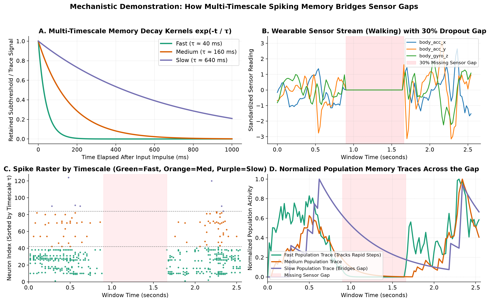

# Robust Wearable Activity Recognition: A Spiking Network with Multiple Memory Timescales

**Brain-Inspired Computing — Master's Project (`robust_wearable_snn`)**

Can neural memory preserve human activity recognition when wearable sensor readings disappear? This repository implements a controlled, reproducible empirical study comparing a **homogeneous spiking reservoir** (single shared membrane/synaptic timescale $\tau_m$) against a **heterogeneous multi-timescale spiking reservoir** (mixing fast, medium, and slow timescales) on the **UCI Human Activity Recognition (UCI HAR)** dataset under synthetic sensor dropout.

---

## Key Empirical Results (5 Paired Random Seeds)

On **clean data (0% missing)**, the single-timescale Homogeneous LIF reservoir ($\tau_m = 80\text{ ms}$) slightly edges out the Heterogeneous LIF reservoir ($[40, 160, 640]\text{ ms}$) by `0.91%` (`93.92%` vs. `93.01%` Macro-F1). However, as contiguous blocks of sensor data disappear (**20%, 30%, and 40% intermittent gaps**), the Homogeneous model loses temporal context faster, whereas the **Heterogeneous LIF model retains +2.60% higher Macro-F1 at 30% dropout (`85.96%` vs. `83.36%`) and +3.86% higher Macro-F1 at 40% dropout (`78.51%` vs. `74.65%`)**, while using **30.4% fewer spikes and synaptic operations**.

| Condition | Heterogeneous LIF (Mixed $\tau$) | Homogeneous LIF (Single $\tau$) | Non-Spiking ESN Baseline | Feature Classifier Baseline |
| :--- | :---: | :---: | :---: | :---: |
| **0% Missing (Clean)** | `93.01 ± 0.57%` | **`93.92 ± 0.38%`** | `92.46 ± 0.51%` | `88.19 ± 0.00%` |
| **10% Intermittent Gap** | `92.37 ± 0.22%` | **`93.16 ± 0.39%`** | `92.01 ± 0.38%` | `80.39 ± 0.00%` |
| **20% Intermittent Gap** | **`90.46 ± 1.24%`** | `90.11 ± 1.17%` | `88.28 ± 1.57%` | `70.08 ± 0.00%` |
| **30% Intermittent Gap** | **`85.96 ± 6.91%`** | `83.36 ± 4.28%` | `75.08 ± 6.16%` | `56.92 ± 0.00%` |
| **40% Intermittent Gap** | **`78.51 ± 11.59%`** | `74.65 ± 8.81%` | `59.61 ± 8.03%` | `45.26 ± 0.00%` |
| **Accuracy Drop at 30% Gap** | **`-6.96%`** | `-10.46%` | `-16.66%` | `-28.06%` |
| **Single-Axis Channel Loss (Mean)** | `85.27 ± 0.58%` | `85.96 ± 1.06%` | **`86.05 ± 0.89%`** | `69.83 ± 0.00%` |
| **Clean Spikes / Window** | **`938.5`** (`2.86 Hz`) | `1,348.7` (`4.11 Hz`) | N/A (Continuous) | N/A |
| **Clean SynOps / Window** | **`23,219`** | `33,466` | `94,976` MACs | N/A |

### Generated Figures







---

## Experimental Design & Safeguards

1. **Dataset & Zero-Leakage Participant Split (`src/data/dataset.py`):**
   - **UCI HAR Dataset:** 30 participants, 50 Hz sampling rate, 128 readings per window ($2.56\text{ s}$), 6 activities (`Walking`, `Upstairs`, `Downstairs`, `Sitting`, `Standing`, `Lying down`).
   - Preserves the official participant-separated test set (9 unseen participants, 2,947 windows).
   - Holds out 5 training participants (1,960 windows) strictly for validation hyperparameter selection, fitting standardization (`mean`, `std`) and readout weights on the remaining 16 training participants (5,392 windows).
2. **Matched Comparison Controls (`src/spiking/lif_reservoir.py`):**
   - Identical neuron count ($N = 128$, chosen via early runtime pilot), excitatory/inhibitory balance (80% E / 20% I), sparse recurrent graph ($p_{\text{rec}} = 0.15$), spectral radius scaling, ON/OFF sensory input encoding, and linear readout (`BalancedRidgeReadout`).
   - **Paired Random Seeds (`seeds = [0, 1, 2, 3, 4]`):** For each seed $s$, both the Homogeneous and Heterogeneous reservoirs share the exact same input projection matrix $W_{\text{in}}^{(s)}$ and recurrent weight matrix $W_{\text{rec}}^{(s)}$; only the neuron timescale distribution $\boldsymbol{\tau}_m$ differs.
   - **Equal Tuning Budget (`scripts/03_tune_time_constants.py`):** Both models evaluate 24 hyperparameter configurations (6 timescale candidates $\times$ 4 readout regularization values) on the clean training-participant validation split.
3. **Two Missing-Data Dropout Conditions (`src/data/corruption.py`):**
   - **Intermittent Block Gaps:** Contiguous blocks of readings removed at **0%, 10%, 20%, 30%, and 40%** of the window length, replaced with `0.0` after standardization using identical saved boolean masks across all models.
   - **Single-Axis Channel Loss:** Each individual sensor axis zeroed for the full 128-step window.
4. **Conventional Baselines (`src/baselines/`):**
   - **Feature Classifier (`feature_baseline.py`):** Statistical and temporal window features with a linear readout.
   - **Non-Spiking Reservoir (`esn_baseline.py`):** Matched Leaky Echo State Network (`tanh` activation) with identical connectivity.

---

## Four-Person Team Ownership (Slide 12)

| Owner | Module Ownership | Primary Responsibility |
| :--- | :--- | :--- |
| **1 · Data & Evaluation** | `src/data/`, `scripts/01_prepare_data.py` | UCI HAR preprocessing, participant-safe splits, deterministic corruption masks |
| **2 · Conventional Baselines** | `src/baselines/` | Engineered window-feature classifier and non-spiking Leaky ESN baseline |
| **3 · Spiking Models** | `src/spiking/`, `scripts/02_runtime_pilot.py`, `scripts/03_tune_time_constants.py` | Homogeneous and heterogeneous LIF reservoirs, runtime pilot, validation tuning |
| **4 · Analysis & Demo** | `src/evaluation/`, `scripts/04_run_experiments.py`, `scripts/05_generate_figures.py` | Paired-seed experiments, activity-cost analysis, robustness curves, raster demo |

---

## Quickstart: Run the Reproducible Pipeline

```bash
# Install dependencies
pip install -r requirements.txt

# Milestone 0: Download UCI HAR, build participant splits & save corruption masks
python3 scripts/01_prepare_data.py

# Milestone 1: Run early runtime & firing-rate pilot (N=128 vs N=256)
python3 scripts/02_runtime_pilot.py

# Milestone 2: Run equal-budget validation tuning (training participants only)
python3 scripts/03_tune_time_constants.py

# Milestone 3: Run 5-seed matched evaluation across clean & dropout conditions
python3 scripts/04_run_experiments.py

# Milestone 4: Generate all 5 publication figures & mechanistic raster demo
python3 scripts/05_generate_figures.py
```

---

## References
1. **UCI HAR Dataset:** Anguita et al. (2013), *Human Activity Recognition Using Smartphones*, UCI Machine Learning Repository.
2. **Li et al. (2023):** *Efficient human activity recognition with spatio-temporal spiking neural networks*, Frontiers in Neuroscience.
3. **Perez-Nieves et al. (2021):** *Neural heterogeneity promotes robust learning*, Nature Communications.
4. **Agrawal et al. (2026):** *A Spiking Heterogeneous Harmonic Resonate-and-Fire State Space Model for Time Series*, PMLR.
